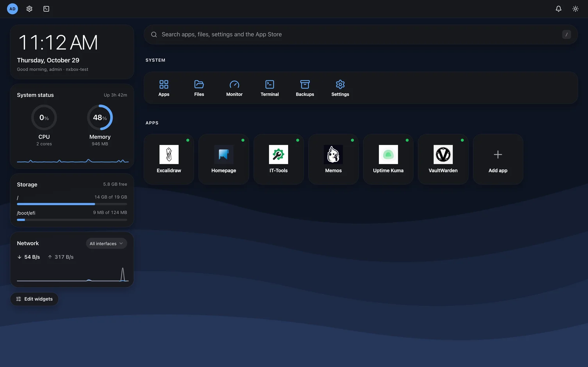
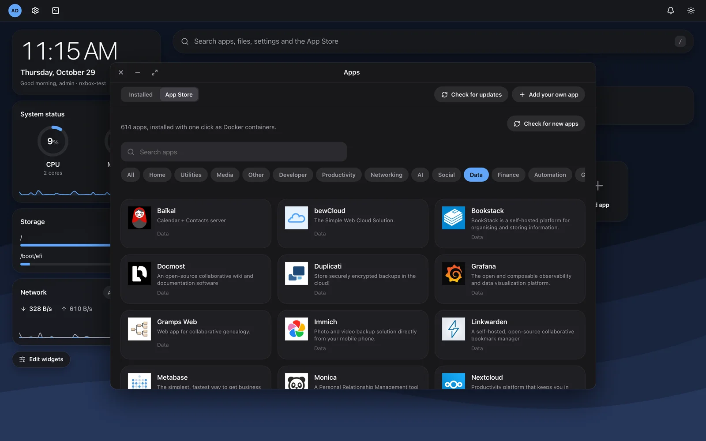
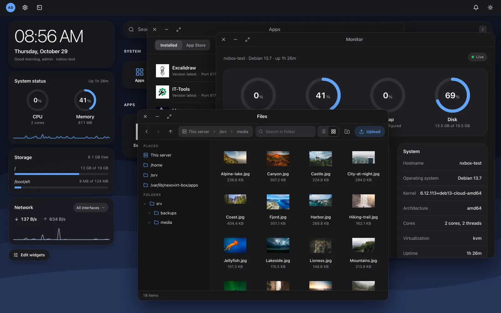

# NexoVirt Box

A web UI on top of a normal Linux server, part of the [NexoVirt](https://nexovirt.com) family.
Your server stays a normal server (SSH, your own services and config keep working); Box adds a
desktop in the browser.

**Status: early test version (0.x).** It shows the live system load (CPU per thread, memory, swap,
load average, uptime, the last 10 minutes as charts), the mounted drives and the network
throughput, and has:

- an **app store** with 600+ Docker apps (install with your own data folder, open, start, stop,
  restart, update notices, logs, backups, uninstall) and your own compose apps,
- **HTTPS for apps** under their own domain through a reverse proxy (Caddy, Let's Encrypt when the
  domain points to the server),
- a **file explorer** (browse, upload, download, preview, rename, move, delete, share links),
- **backups** of apps to a local folder, S3-compatible storage or Proxmox Backup Server (encrypted), **Samba/NFS shares**, **disk health** (SMART),
  **system updates** (apt) and **notifications**,
- **firewall** rules with automatic undo when a change locks you out,
- a root **console** in the browser, an **activity log**, two-step sign-in (authenticator app,
  passkeys, recovery codes) and signed self-updates.

## Screenshots







## Requirements

- Debian 12 or 13, or Ubuntu 22.04 or 24.04, with systemd
- amd64 or arm64
- Docker is optional: Box offers to install it the first time you open the App Store

## Install

As root, with the latest release:

```sh
curl -fsSL https://raw.githubusercontent.com/NexoVirt/nexovirt-box/main/deploy/get.sh | sudo sh
```

`get.sh` checks the system and CPU, downloads the release manifest, verifies its Ed25519 signature
(openssl) and the sha256 of the binary and of `install.sh`, then installs. Run it again to upgrade;
it does nothing when the newest version is already installed. `NEXOVIRT_BOX_VERSION=0.2.0` pins a
version. (While the repository is private, release files need `GITHUB_TOKEN=<token with repo read>`.)

From a local build instead:

```sh
sudo sh deploy/install.sh ./bin/nexovirt-box-linux-amd64
```

Open `https://<server-ip>:8443`. The browser warns once about the self-signed certificate.
The first page asks for the **setup code** printed by the installer (also in
`/var/lib/nexovirt-box/web/setup-token`), then you create the admin account. The code is deleted
once the account exists, so nobody else on the network can claim a fresh Box.

To get update notices inside Box, set Settings > Box updates > Update address to
`https://github.com/NexoVirt/nexovirt-box/releases/latest/download`.

## Build from source

Needs Go (version in `go.mod`) and Node 22+.

```sh
make build   # builds the UI, then bin/nexovirt-box-linux-{amd64,arm64}
make test    # go vet + go test
```

Development: `go run . -dev -listen 127.0.0.1:8080 -state ./tmp` (plain HTTP, never use `-dev`
on a reachable server) and `cd web && npm run dev` for the UI with hot reload. More in
[docs/DEVELOPMENT.md](docs/DEVELOPMENT.md).

## Security model

- The web UI runs as the unprivileged user `nexovirt-box`. Root work (console, Docker, firewall,
  files, reverse proxy, updates) goes through `nexovirt-box helper`, a root service on a unix
  socket that only the web user may use and that only knows a fixed list of typed actions.
- The console is a root shell. The helper itself checks the password (and the 2FA code) and gives
  out a 5-minute proof bound to the session; without it the helper refuses to start a shell, so
  even a compromised web process cannot open one. Signing out closes open consoles.
- Two-step sign-in: TOTP with 10 single-use recovery codes, and passkeys. Browsers only allow
  passkeys on a domain name with a trusted certificate (or localhost), not on an IP address.
- Docker is only used through the helper, and it only runs app definitions from the catalog
  signed by NexoVirt. Generated passwords and your answers are in a private `.env` per app; the
  compose file is never rewritten.
- Firewall: Box only changes its own rules (its own nftables table, ufw rules tagged
  `nexovirt-box:`, or the firewalld rich rules it added) and shows the others read only. Each
  change must be confirmed within 60 seconds with a new request, else the helper restores the
  previous rules. Blocking the Box port needs a typed confirmation.
- Files: every path is resolved and must stay inside the allowed folders; /etc, /root, /proc,
  /sys, /dev, /boot and /run are refused (only an edit of `/etc/nexovirt-box/files.json` on the
  server can allow them). Previews are sandboxed; SVG and HTML are always downloads.
- Reverse proxy: Box never takes over a port another program uses; with 80/443 taken you pick
  other ports.
- Self-updates: only releases signed with the NexoVirt release key, applied on click; when the
  new version does not answer, the old binary is restored.
- Failed sign-ins, setup and password confirmations are limited to 5 per minute per IP (counted
  atomically, also across restarts). `X-Forwarded-For` is only trusted from `-trusted-proxies`.
- Passwords are bcrypt hashes; sessions SHA-256 hashes of random tokens; the database is readable
  by the web user only.

Report security problems privately, see [SECURITY.md](SECURITY.md).

## Releases

Pushing a tag `v*` runs `.github/workflows/release.yml`: it builds both binaries with the version
stamped, writes `SHA256SUMS`, signs `latest.json` with the release key (a repository secret) and
publishes a GitHub release with all files. Box's self-updater and `get.sh` read
`latest.json` + `latest.json.sig` from `https://github.com/NexoVirt/nexovirt-box/releases/latest/download`.

## App catalog

The built-in catalog is imported from the
[Runtipi App Store](https://github.com/runtipi/runtipi-appstore) (GPL-3.0),
the [CasaOS App Store](https://github.com/IceWhaleTech/CasaOS-AppStore) (Apache-2.0) and
[BigBearCasaOS](https://github.com/bigbeartechworld/big-bear-casaos) (MIT); every app shows
where it came from, and the license texts are in `catalog/LICENSES/`. App names and icons
belong to their projects. See `docs/app-store.md`.

## Tech

Go (standard library HTTP server, SQLite via modernc.org/sqlite, gopsutil, creack/pty,
coder/websocket, go-webauthn, go-qrcode, yaml.v3 in the catalog importer; apps run with
`docker compose`, the reverse proxy is the official Caddy image) with a Svelte 5 UI using its own Apple-inspired design system (plain CSS, no UI framework)
and [Lucide](https://lucide.dev) icons (ISC), built into the binary.

## Contributing

See [CONTRIBUTING.md](CONTRIBUTING.md). Contributions need a signed [CLA](CLA.md) (the CLA bot asks
on your first pull request). Please follow the [Code of Conduct](CODE_OF_CONDUCT.md).

## License

AGPL-3.0. See [LICENSE](LICENSE).
