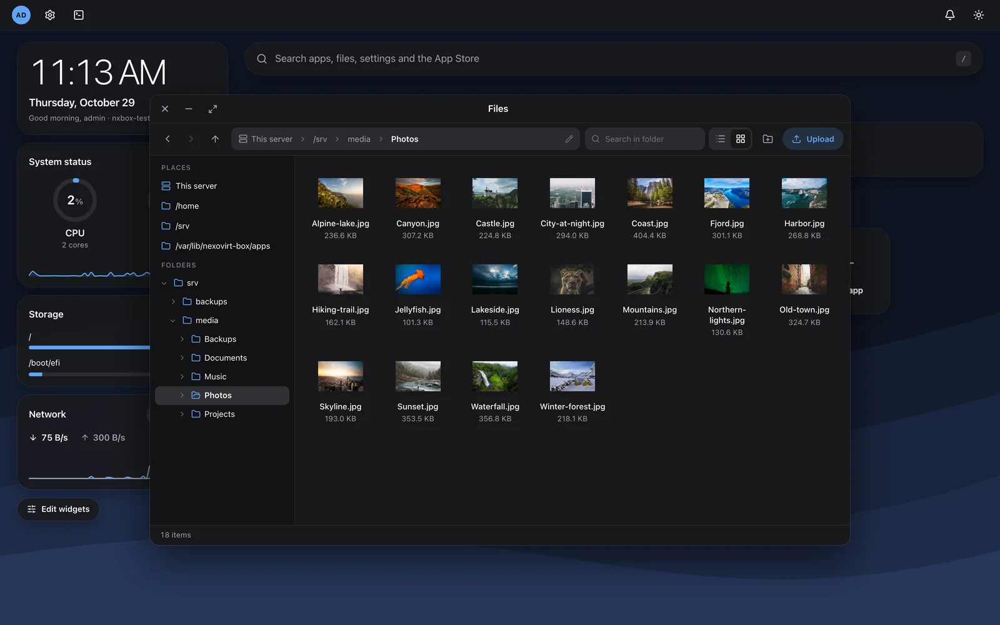

<div align="center">

<picture>
  <source media="(prefers-color-scheme: dark)" srcset="docs/branding/box-mark-white.svg">
  
</picture>

# NexoVirt Box

**A clean web desktop for your own small server.**

Apps in one click, files, backups and a firewall you can't lock yourself out of.
Free and open source.

[](https://github.com/NexoVirt/nexovirt-box/actions/workflows/ci.yml)
[](LICENSE)


</div>

> [!NOTE]
> **Early test version (0.x).** Things will change before 1.0.

## Why Box?

Box installs **on top of a normal Debian or Ubuntu server**. Your server stays yours: SSH, your own
services and your own config keep working. Box just adds a desktop in the browser.

## Features

| | |
|---|---|
| 🖥️ **Web desktop** | App tiles, live widgets for CPU, memory, storage and network, floating windows |
| 🛒 **App store** | 600+ Docker apps, generated passwords, update notices, logs, your own compose apps |
| 🔒 **HTTPS for apps** | Your own domain per app through a built-in reverse proxy (Caddy, Let's Encrypt) |
| 📁 **Files** | Finder-style explorer with upload, preview, drag and drop and share links |
| 💾 **Backups** | Encrypted, to a local folder, S3 or Proxmox Backup Server, with one-click restore |
| 🧱 **Firewall** | Every change rolls back after 60 seconds unless you confirm it |
| 🔄 **System** | apt updates, disk health (SMART), Samba and NFS shares, notifications |
| 🛡️ **Security** | Web UI without root, root console behind a fresh password, 2FA and passkeys, signed updates |

## Install

As root on Debian 12/13 or Ubuntu 22.04/24.04 (amd64 or arm64):

```sh
curl -fsSL https://raw.githubusercontent.com/NexoVirt/nexovirt-box/main/deploy/get.sh | sudo sh
```

Then open **`https://<server-ip>:8443`**, enter the setup code the installer printed and create
your admin account. Run the same command again to upgrade.

<details>
<summary>More install options</summary>

- `get.sh` checks the system, verifies the release signature (Ed25519) and the checksums, then
  installs. It does nothing when the newest version is already installed.
- Pin a version: `NEXOVIRT_BOX_VERSION=0.2.0`.
- While the repository is private, release files need `GITHUB_TOKEN=<token with repo read>`.
- From a local build: `sudo sh deploy/install.sh ./bin/nexovirt-box-linux-amd64`.
- The setup code is also in `/var/lib/nexovirt-box/web/setup-token` and is deleted once the
  admin account exists.
- Docker is optional: Box offers to install it the first time you open the App Store.
- Update and catalog addresses default to this repository and can be changed in Settings.

</details>

## Screenshots

| App store | Files |
|---|---|
|  |  |


## Build from source

Needs Go (version in `go.mod`) and Node 22+.

```sh
make build   # UI, then bin/nexovirt-box-linux-{amd64,arm64}
make test    # go vet + go test
```

Development setup: [docs/DEVELOPMENT.md](docs/DEVELOPMENT.md).

## Documentation

- [Security model](docs/security-model.md)
- [App store and catalog](docs/app-store.md)
- [Backups](docs/backups.md)
- [Releases and tech stack](docs/releases.md)
- [Development](docs/DEVELOPMENT.md)

## App catalog

Imported from the [Runtipi App Store](https://github.com/runtipi/runtipi-appstore) (GPL-3.0), the
[CasaOS App Store](https://github.com/IceWhaleTech/CasaOS-AppStore) (Apache-2.0) and
[BigBearCasaOS](https://github.com/bigbeartechworld/big-bear-casaos) (MIT). Every app shows where it
came from; license texts are in `catalog/LICENSES/`. App names and icons belong to their projects.

## Contributing

Contributions are welcome. See [CONTRIBUTING.md](.github/CONTRIBUTING.md). Pull requests need a
signed [CLA](.github/CLA.md); the CLA bot asks on your first one. Please follow the
[Code of Conduct](.github/CODE_OF_CONDUCT.md). Security problems: see [SECURITY.md](.github/SECURITY.md).

## License

[AGPL-3.0](LICENSE). Part of the [NexoVirt](https://nexovirt.com) family.
